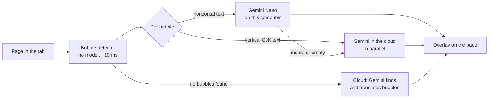

<div align="center">

<a href="https://mangit.app/?utm_source=github&utm_medium=readme"></a>

# Mangit Web: free online manga translator

**Translate manga, manhwa and manhua pages in your browser, privately and at no cost.**
In desktop Chrome, Gemini Nano reads the speech bubbles on your own computer; only the hard ones go to Gemini in the cloud.

### [→ Translate a page now at mangit.app/translate](https://mangit.app/translate/?utm_source=github&utm_medium=readme)

<a href="https://mangit.app/translate/?utm_source=github&utm_medium=readme"></a>

**Also on your phone:** the Mangit app for iPhone and Android redraws whole chapters in your language.

<a href="https://apps.apple.com/app/mangit/id6756326988?pt=126724485&ct=github&mt=8"></a>&nbsp;&nbsp;<a href="https://play.google.com/store/apps/details?id=com.measify.mangit&referrer=utm_source%3Dgithub%26utm_medium%3Dreadme%26utm_campaign%3Dmangit_web"></a>

[Website](https://mangit.app/?utm_source=github&utm_medium=readme) · [Web translator](https://mangit.app/translate/?utm_source=github&utm_medium=readme) · [Chrome extension](#install-the-extension) · [How it works](#how-the-hybrid-works) · [Results](#results)

</div>

## What it does

- **Translate manga online:** open [mangit.app/translate](https://mangit.app/translate/?utm_source=github&utm_medium=readme), drop in a page and read it in English or 13 other languages. Japanese, Korean and Chinese manga, manhwa, manhua and webtoon pages. No install, no account.
- **Whole chapters:** open a PDF, CBZ, CBR or EPUB chapter, translate every page, and download it translated as CBZ or PDF. Files are read in the browser and never uploaded.
- **Private by default:** in On-device mode Gemini Nano reads every bubble on your computer and nothing leaves it, even offline. Hybrid mode sends only the hard bubbles, such as vertical Japanese, to the cloud.
- **Mangit for Chrome:** the same engine as a Chrome extension that translates the manga page you're reading on any website, from a side panel. [Install](#install-the-extension)
- **Learn as you read:** hover any bubble to see the original text, the translation and which model read it.
- **Open source:** Apache 2.0. Built on the [Firebase AI Logic](https://firebase.google.com/docs/ai-logic) hybrid inference SDK for [#BuildHybridAI](https://firebasehybridaihackathon.devpost.com/).

## Why

Millions of people read manga, manhwa and manhua that were never translated into their language. Today they either wait, or upload every page they read to a cloud service. Mangit Web keeps most of that reading on the reader's own computer:

- **Private:** in On-device mode no image leaves the computer, and the panel shows a live count of what did.
- **Free and offline:** Gemini Nano runs locally at no cost and keeps working without a connection.
- **Still accurate:** the bubbles a small on-device model is bad at go to Gemini in the cloud, in parallel, so the page stays fast.

## How the hybrid works



1. **Find bubbles without a model.** A few milliseconds of image analysis (`src/lib/bubbles.js`) find enclosed light regions with ink inside, plus each bubble's shape and text direction. Nothing is sent anywhere.
2. **Route by difficulty.** Our benchmark showed Gemini Nano reads horizontal Korean and Chinese well but misreads vertical Japanese. Hybrid mode sends vertical bubbles straight to the cloud and lets Nano read the rest (`src/lib/pipeline.js`).
3. **Second opinions.** A bubble Nano returns empty, untranslated or marked unsure is re-asked in the cloud, within a per-page budget set in Remote Config.
4. **Small crops.** Every request is one bubble, so on-device prompts stay far under Nano's 9,216-token limit and cloud requests run in parallel.
5. **One SDK for both paths.** Each request goes through `getGenerativeModel` with `InferenceMode.PREFER_ON_DEVICE`, `ONLY_ON_DEVICE` or `ONLY_IN_CLOUD`, the same JSON schema on both sides, and `response.inferenceSource` tells the UI which model answered each bubble (`src/lib/translator.js`).

## Results

15 test pages (5 Japanese vertical, 5 Korean, 5 Chinese) with known bubble positions and text, translated to English. Chrome 158, MacBook Pro M1 Pro. Run it yourself with `npm run bench`.

| Mode | Bubbles found | Text read right | Names right | Bubbles on your computer | First bubble | Whole page |
|---|---|---|---|---|---|---|
| On-device | 99% | 77% | 63% | 100% | 3.2 s | 13.3 s |
| **Hybrid** | 99% | **94%** | 83% | **62%** | **2.0 s** | **9.1 s** |
| **Hybrid + shared names** | 99% | 94% | **94%** | 63% | 1.9 s | 8.4 s |
| Cloud | 99% | 100% | 92% | 0% | 1.7 s | 14.1 s* |

- "Text read right" is the character similarity between what the model read and the real text. "Names right" checks that character names come out recognisably.
- Per language, Gemini Nano alone read Korean 93% and Chinese 91% right, but vertical Japanese only 51%. That gap is why Hybrid routes vertical text to the cloud: Japanese pages in Hybrid read 99% right in 6.3 s instead of 51% in 16.4 s.
- Shared names (the Firestore glossary) lift names right from 83% to 94% without changing the on-device share.
- *The benchmark sends a whole chapter's bubbles to the cloud in a burst and hits the per-user rate limit; a single page in normal use takes 2–4 s in Cloud mode.
- Gemini Nano occasionally takes very long on a bubble. Hybrid gives it 20 s, then asks the cloud; On-device waits up to 90 s and never uses the network.
- The bubble detector alone finds 96% of bubbles and identifies text direction and shape on 69 of 69 bubbles (`npm run test:detector`).
- Results JSON: [`bench/results/`](bench/results). Test pages are our own drawings in [`bench/data/`](bench/data).

## Firebase products used

| Product | What for |
|---|---|
| **Firebase AI Logic** (hybrid inference) | Gemini Nano on-device and Gemini in the cloud through one SDK, structured JSON output on both, `inferenceSource` per answer |
| **App Check** | Protects the Gemini API. The web demo attests with reCAPTCHA Enterprise; the extension (whose `chrome-extension://` origin reCAPTCHA can't attest) uses a registered debug token in judging builds |
| **Remote Config** | Tunes routing without a release: cloud models, thinking level, second-opinion budget (0 = fully on-device), vertical-text routing, cloud concurrency |
| **Cloud Firestore** + **Authentication** (anonymous) | Shared character-name glossaries per series, so every reader of a series gets the same spellings on-device and in the cloud. Security rules cap entry shape and size and forbid deletes |
| **Hosting** | The web demo |

### Cost and abuse guards

- **App Check enforced** on AI Logic, Firestore and Authentication. Requests without a valid App Check token are refused.
- **Rate limit:** 60 cloud requests per minute per user (AI Logic quota).
- **Daily cap per browser:** `daily_cloud_requests_per_browser` (On-device is never limited).
- **Monthly spending shut-off:** a Cloud Billing budget plus two functions in [`functions/`](functions/index.js). `usageGuard` prices this month's Gemini tokens from Cloud Monitoring every 15 minutes; `budgetGuard` listens to budget alerts. Either one sets `cloud_enabled` to 0 at the limit. On-device keeps working, and the guard turns the cloud back on next month.
- **On-device never falls back to the cloud.** If Gemini Nano can't run, Hybrid and On-device ask before sending anything.

### Anonymous usage stats

After each translation the app writes one record to Firestore with counts only: web or extension, mode, pages, bubbles read on-device vs in the cloud, seconds, and an anonymous sign-in ID (to count distinct browsers). No images, text, URLs, titles or names. Clients can only create records, never read them. The `usageGuard` function folds them every 15 minutes into `stats/{day}` (runs, pages, pages by mode, bubbles on-device and cloud, distinct browsers, estimated cost) and `stats_public/total` (shown on the demo page), then deletes the raw records. Offline runs and the benchmark record nothing. `stats_month/{month}` holds the measured cloud cost from the spending guard.

### Remote Config

Everything about routing and cost can be changed without a new release:

| Key | Default | What it does |
|---|---|---|
| `cloud_enabled` | 1 | **Kill switch.** 0 = no cloud calls for anyone; On-device keeps working. Set by the spending guard at the monthly limit |
| `daily_cloud_requests_per_browser` | 800 | Cloud bubble requests per browser per day (about 150 pages in Cloud mode) |
| `max_cloud_escalations_per_page` | 4 | Bubbles per page Nano was unsure about that may get a cloud second opinion. 0 = never |
| `cloud_first_vertical` | 1 | Hybrid: vertical CJK bubbles (Nano's weak spot) go straight to the cloud. 0 = Nano tries everything |
| `cloud_fast_model` | gemini-3.5-flash-lite | Model for single bubbles |
| `cloud_page_model` | gemini-3.8-flash | Model that finds and translates bubbles on a whole page (when the detector finds none) |
| `cloud_bubble_thinking` / `cloud_page_thinking` | MINIMAL / LOW | Thinking level per model: speed against care |
| `cloud_concurrency` | 6 | Cloud bubble requests in flight per page |
| `device_languages` | en,es,ja | Target languages Gemini Nano writes; others use the cloud |
| `min_bubbles_for_device_path` | 1 | Fewer detected bubbles than this sends the page to the whole-page cloud model |

In an emergency (unexpected traffic, a bad model), set `cloud_enabled` to 0 and publish: open pages stop calling the cloud within 5 minutes.

## Install the extension

1. Download `mangit-web-extension.zip` from the [latest release](https://github.com/mirzemehdi/mangit-web/releases/latest) and unzip it.
2. Open `chrome://extensions`, turn on **Developer mode**, click **Load unpacked** and pick the folder.
3. Open a manga page (or the [demo reader](https://mangit.app/translate/reader.html)), click the Mangit Web icon and press **Translate this page** (Alt+T).

For on-device translation, Chrome needs Gemini Nano: Chrome 139+ on desktop, with `chrome://flags/#prompt-api-for-gemini-nano-multimodal-input` enabled. The side panel offers the one-time model download. Without Nano, Hybrid uses the cloud.

## Build from source

```bash
npm install
cp .env.example .env.local   # fill in your Firebase web app config
npm run build                # dist/ (extension), web-dist/ (demo), bench-dist/ (benchmark)
```

Your Firebase project needs AI Logic set up, App Check enforced with a debug token registered (see `.env.example`), anonymous Authentication, Firestore, and `firebase deploy --only firestore:rules`.

| Command | What it does |
|---|---|
| `npm run bench` | Serves the benchmark page on localhost |
| `node scripts/bench-chrome.mjs device,auto,cloud 5` | Runs the benchmark in Chrome with Gemini Nano and saves JSON |
| `node scripts/e2e-extension.mjs auto ja_school` | Loads the extension, translates the demo reader, saves screenshots |
| `npm run test:detector` | Bubble detector against the ground truth |
| `node scripts/make-samples.mjs` | Builds sample PDF, CBZ and EPUB chapters from the demo pages |
| `node scripts/e2e-library.mjs web/samples/qingyun-sect-ch1.epub` | Extension chapter page: open a file, translate the chapter, download CBZ |

## Project layout

```
src/lib/bubbles.js         bubble detection, shape and text direction (no model)
src/lib/pipeline.js        hybrid routing per bubble
src/lib/translator.js      Firebase AI Logic models, prompts, JSON schemas
src/lib/firebase.js        App Check, Remote Config defaults
src/lib/sharedGlossary.js  Firestore glossaries per series
src/lib/overlay.js         lettering the translation over the page, learner hover card
src/lib/chapter.js         reading PDF (pdf.js), CBZ/ZIP and EPUB (fflate), CBR/RAR (unrar wasm)
src/lib/exporter.js        lettering into the image, translated CBZ/PDF download (pdf-lib)
src/sidepanel.*            extension UI          src/content.js  page overlay
src/web.js, web/           hosted demo           src/bench.js    benchmark
```

## Built during the hackathon

Everything in this repository was written for #BuildHybridAI (Nov 24–30, 2026). Mangit Web comes from the team behind [Mangit](https://mangit.app), a mobile app that translates whole manga chapters with cleaned art. Mangit's own code is not part of this project. Mangit Web is the open, free, browser-side counterpart: it brings what we learned about manga translation (bubble handling, consistent names, reading order) to on-device AI.

The demo chapters are original drawings made for testing. Please use Mangit Web on content you have the right to read.

## Mangit on your phone

Mangit Web writes the translation over each speech bubble. The **Mangit app** for iPhone and Android goes further: it redraws the whole page in your language, cleans the original text from the art, translates sound effects and keeps character names consistent across a chapter, in 31 languages.

<a href="https://apps.apple.com/app/mangit/id6756326988?pt=126724485&ct=github&mt=8"></a>&nbsp;&nbsp;<a href="https://play.google.com/store/apps/details?id=com.measify.mangit&referrer=utm_source%3Dgithub%26utm_medium%3Dreadme%26utm_campaign%3Dmangit_web"></a>

More at [mangit.app](https://mangit.app/?utm_source=github&utm_medium=readme).

## License

[Apache 2.0](LICENSE). Fonts: Sora and Baloo 2, SIL Open Font License 1.1 (`public/fonts/`).
